# TP3 – Serveur multi-threads (sockets TCP)

Matière : Développement d'applications réparties – LSI3 – FSS – 2026/2027

## Contenu

```
TP3/
├── README.md
└── src/
    ├── activite31/   # Activité 3-1 : acceptation de plusieurs clients
    │   ├── Server.java
    │   ├── ClientProcess.java
    │   └── Client.java
    └── activite32/   # Activité 3-2 : calculatrice multi-thread (objets) + compteur global
        ├── Server.java
        ├── ClientProcess.java
        ├── Client.java
        ├── Operation.java   (Serializable)
        └── Compteur.java    (compteur global synchronisé)
```

## Principe

- Le serveur écoute sur le port **1234** et boucle sur `accept()`.
- À chaque connexion, il incrémente le numéro d'ordre, affiche l'IP du client
  (`getRemoteSocketAddress()`) et lance un **thread `ClientProcess`** dédié.
- Activité 3-1 : échange de texte (le client reçoit son numéro d'ordre).
- Activité 3-2 : échange d'objets `Operation` (`ObjectInputStream` / `ObjectOutputStream`)
  et compteur global d'opérations protégé par `synchronized`.

## Activté 3-1 :
**Code du client Java (Client3_1) :**

Le client se connecte au serveur sur le port 1234, lit le message de bienvenue contenant son numéro d'ordre de connexion et l'affiche dans la console. Les erreurs de connexion sont gérées dans le bloc `catch`.
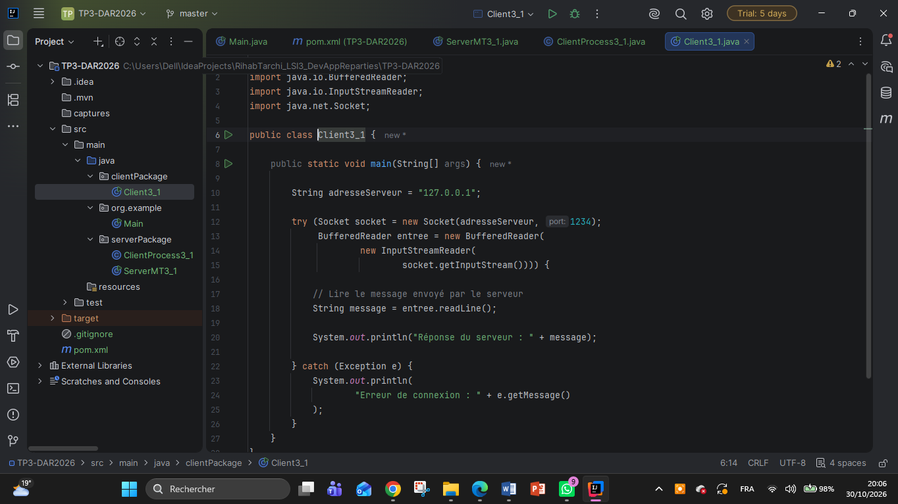

#### Code du thread de traitement ClientProcess3_1

La classe implémente `Runnable` et reçoit le `Socket` du client et son numéro d'ordre. La méthode `run()` envoie au client « Bienvenue ! Vous êtes le client n°X » avec un `PrintWriter`, puis affiche côté serveur le message envoyé. Les erreurs sont gérées dans le `catch`.

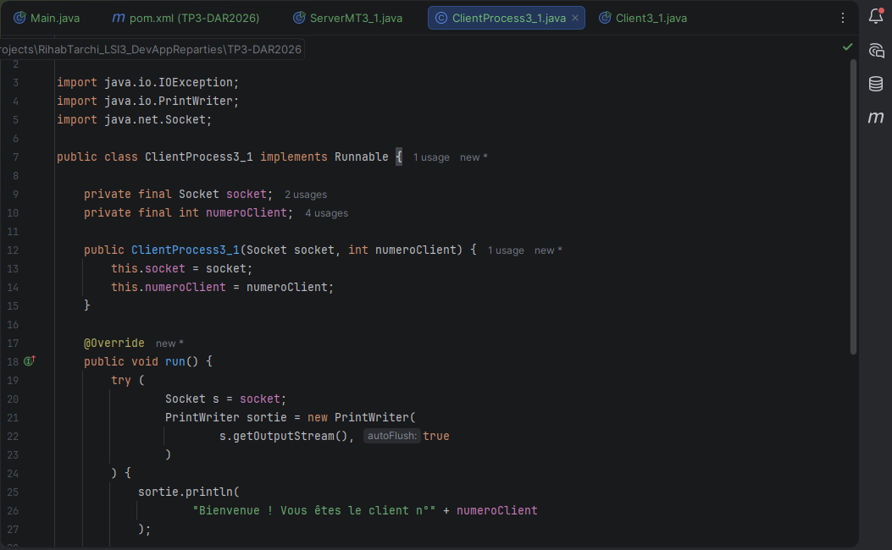

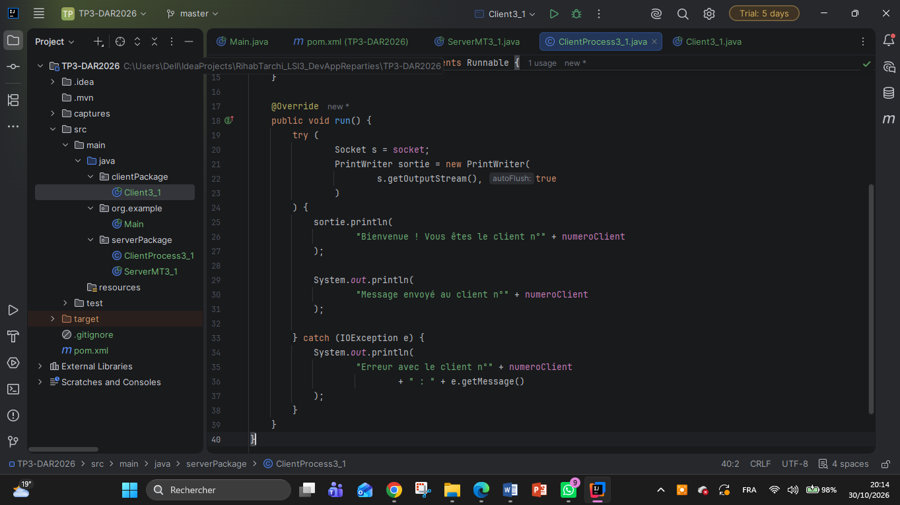

#### Code du serveur multi-thread ServerMT3_1

Le serveur écoute sur le port 1234 (`ServerSocket`). Dans une boucle infinie, il accepte chaque client avec `accept()`, lui attribue un numéro d'ordre unique avec un `AtomicInteger` (`incrementAndGet()`), affiche ce numéro et l'IP du client (`getRemoteSocketAddress()`), puis démarre un thread `ClientProcess3_1` dédié. Il retourne aussitôt à `accept()` pour le client suivant, ce qui permet de servir plusieurs clients en même temps.

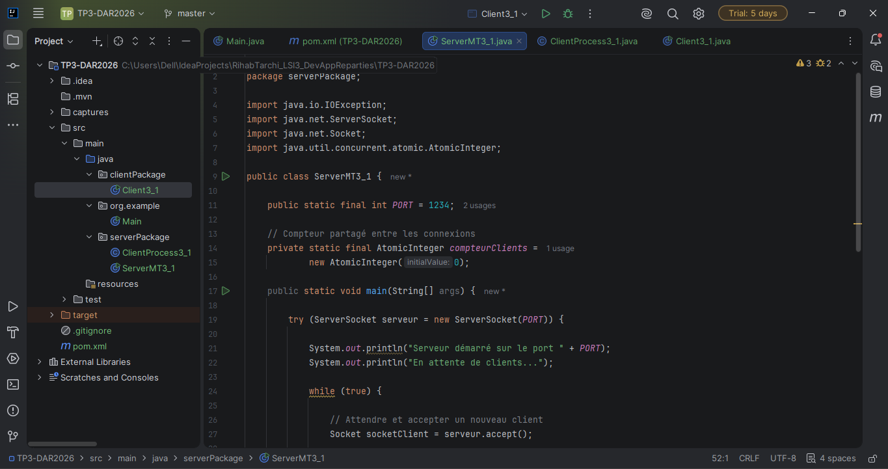

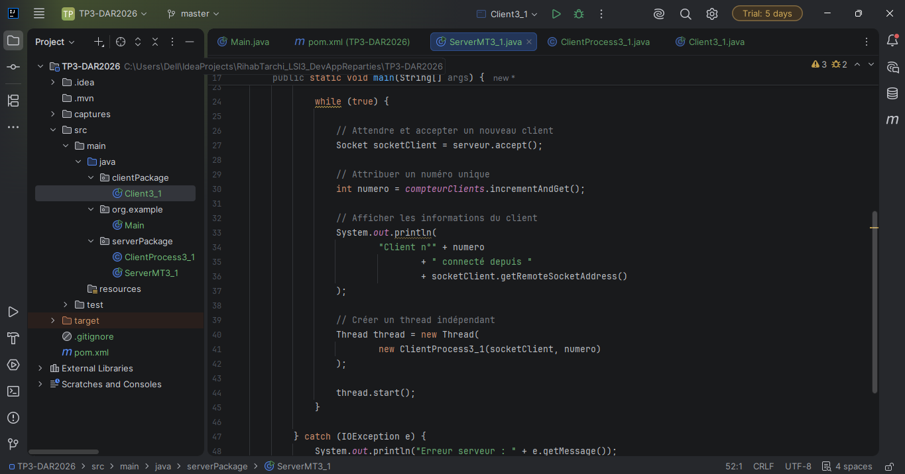

## Activté 3-2 :

#### Code du client calculatrice Client3_2 (communication par objets):

Le client reçoit l'IP du serveur en argument (127.0.0.1 par défaut), se connecte avec `InetSocketAddress`, crée les flux objets (`ObjectOutputStream` avant `ObjectInputStream`), envoie un objet `Operation` avec `writeObject` et affiche le résultat reçu avec `readObject`. Les saisies invalides et les erreurs de connexion sont gérées.

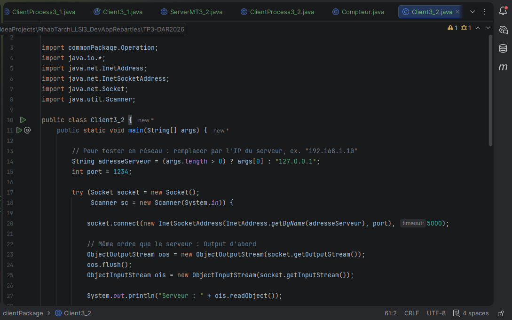

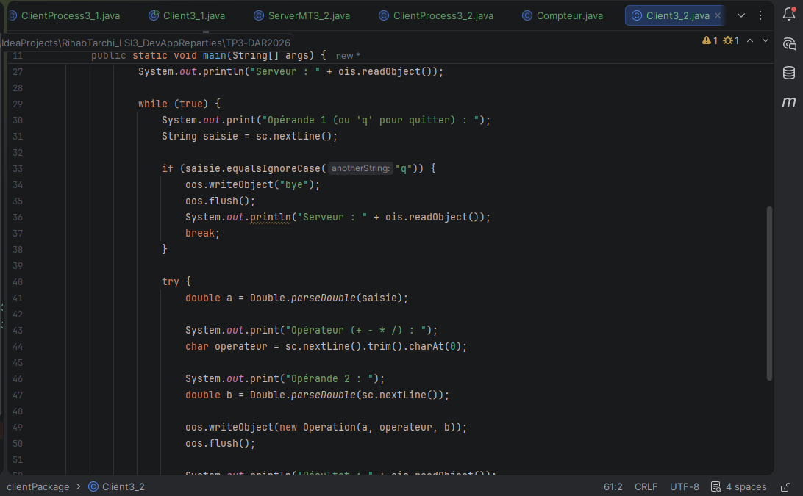

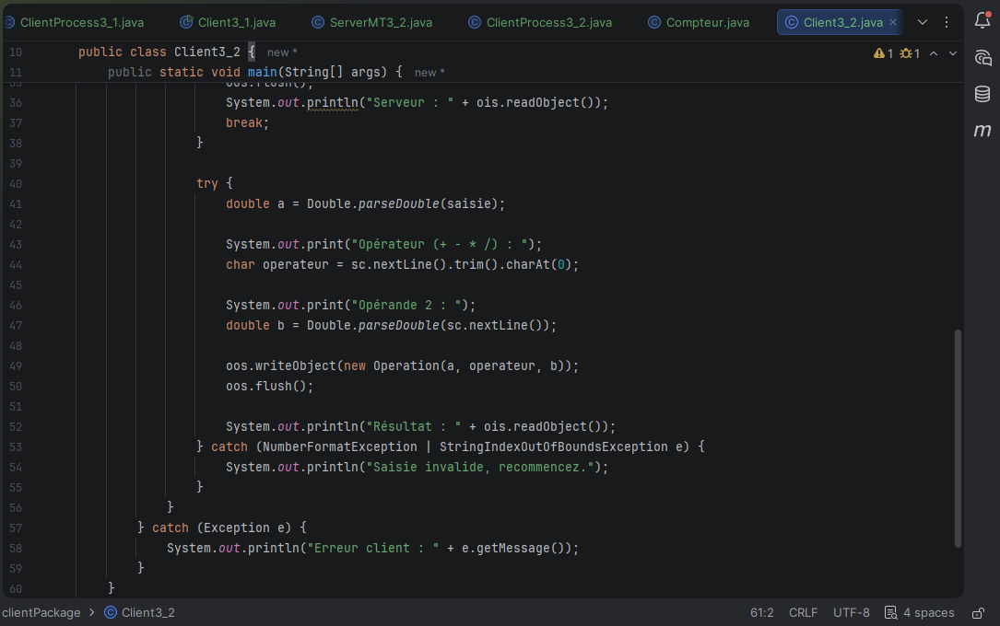

#### Code du thread ClientProcess3_2

Chaque client est servi par un thread `ClientProcess3_2` : création des flux objets (`ObjectOutputStream` avant `ObjectInputStream`), envoi du numéro d'ordre, puis boucle sur `readObject()`. Chaque `Operation` reçue est calculée par `calculer()`, le compteur global est incrémenté avec `Compteur.incrementer()` et le résultat est renvoyé avec `writeObject()`. Le message `"bye"` met fin à la session.

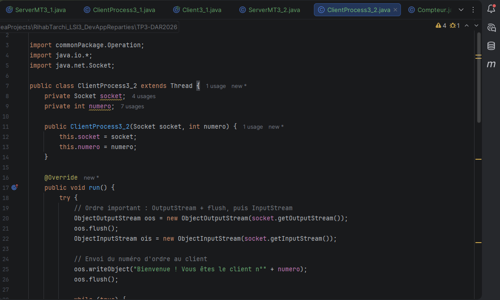

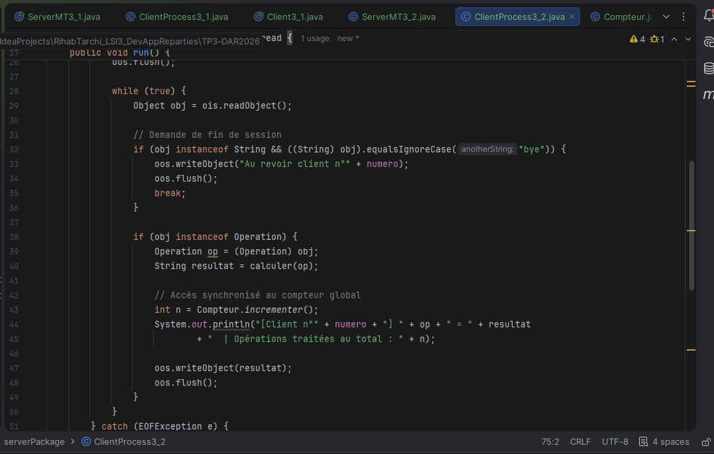

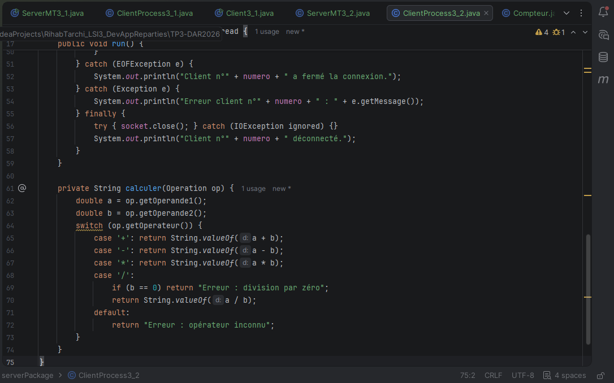

#### Classe Operation (objet échangé entre le client et le serveur)

La classe `Operation` (package `commonPackage`) implémente `Serializable` : elle peut donc être envoyée avec `ObjectOutputStream` et reçue avec `ObjectInputStream`. Elle contient les deux opérandes et l'opérateur, avec leurs accesseurs et une méthode `toString()` pour l'affichage. Le `serialVersionUID` identifie la version de la classe.


#### Structure du projet TP3-DAR2026

Le code des deux activités est organisé en packages : `clientPackage` (clients `Client3_1` et `Client3_2`), `commonPackage` (classe partagée `Operation`) et `serverPackage` (serveurs `ServerMT3_1` et `ServerMT3_2`, threads `ClientProcess3_1` et `ClientProcess3_2`, compteur `Compteur`).

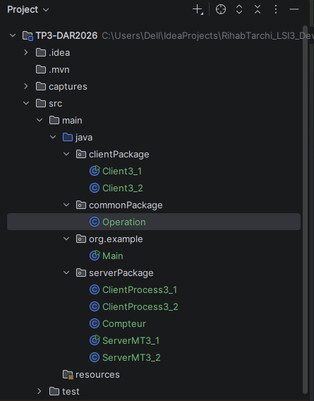

#### Compteur global partagé et synchronisé :

La variable statique `total` est la ressource critique partagée entre les threads `ClientProcess`. Les méthodes `incrementer()` et `getTotal()` sont `synchronized` : un seul thread à la fois peut y entrer, ce qui garantit un compteur cohérent.

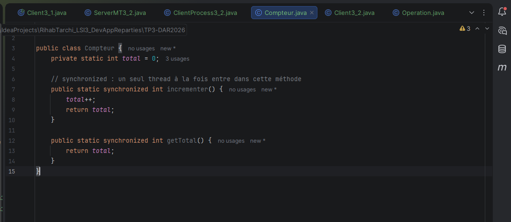

#### Configuration du client avec l'IP du serveur (IntelliJ)

Pour le test en réseau local, la configuration d'exécution `Client3_2` reçoit l'adresse IP du serveur (`192.168.1.118`) dans « Program arguments ». Le client la lit avec `args[0]` et se connecte à cette adresse sur le port 1234 (par défaut : `127.0.0.1`).


## Compilation et exécution

```bash
# Activité 3-1
cd src/activite31
javac *.java
java Server          # terminal 1
java Client          # terminaux 2, 3, ... (ou : telnet localhost 1234)

# Activité 3-2
cd ../activite32
javac *.java
java Server
java Client
```

## Test en réseau local

**1.  Ouverture du port 1234 dans le pare-feu Windows :**
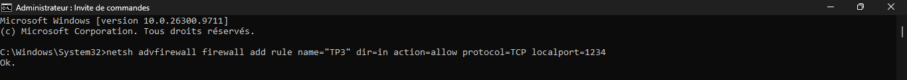
#### Démarrage du serveur

Le serveur `ServerMT3_1` démarre sur le port 1234 et attend les connexions des clients.

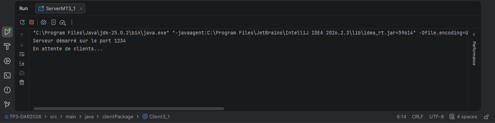

#### Test avec des clients Java

Un premier client `Client3_1` se connecte depuis `127.0.0.1` : le serveur affiche « Client n°1 connecté » et lui envoie son numéro d'ordre.

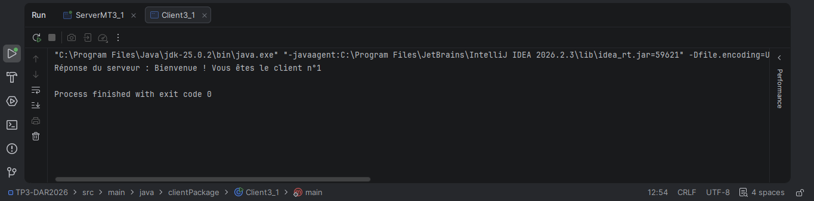

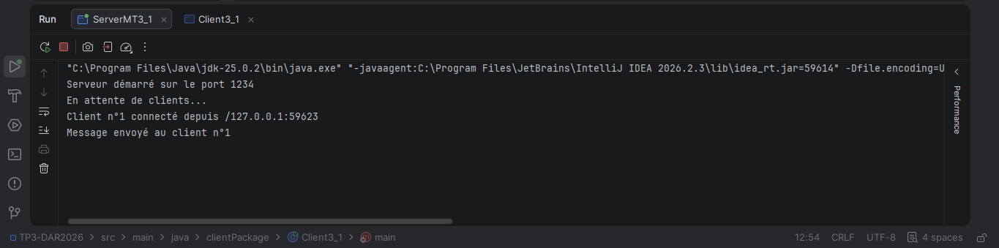

Un deuxième client se connecte ensuite : le serveur reste actif, affiche « Client n°2 connecté » et lui envoie le numéro 2.

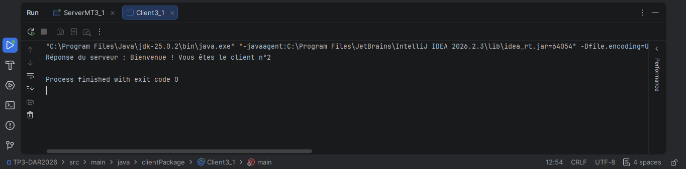

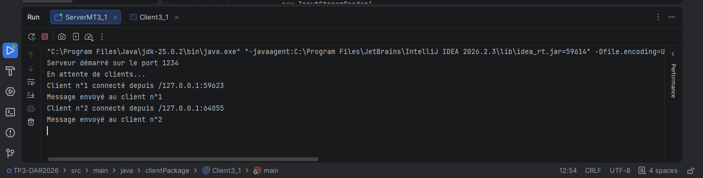

#### Test en réseau local : console du serveur

Le serveur `ServerMT3_1` (machine 192.168.1.118) écoute sur le port 1234. Le client n°1 se connecte depuis l'adresse 192.168.1.116, différente de celle du serveur : la connexion vient bien d'une autre machine du réseau local. Le serveur lui envoie ensuite son numéro d'ordre.

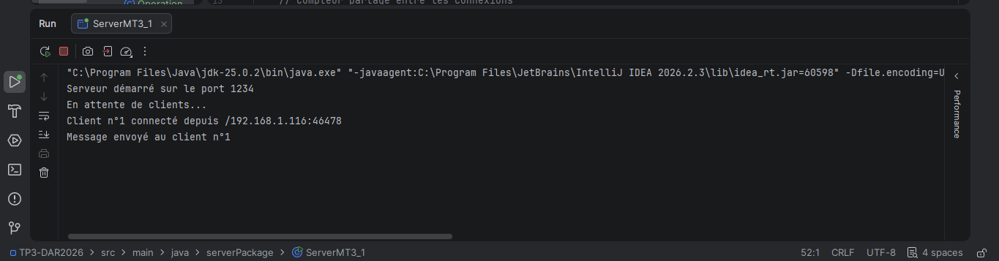

#### Test avec un client Telnet

Un client Telnet (`telnet localhost 1234`) se connecte au serveur et reçoit son numéro d'ordre : « Bienvenue ! Vous êtes le client n°3 ». Le serveur ferme ensuite la connexion (« Perte de la connexion à l'hôte »). Les accents mal affichés viennent de l'encodage de la console Windows (UTF-8 envoyé par Java, lu en page de code DOS), pas du serveur.

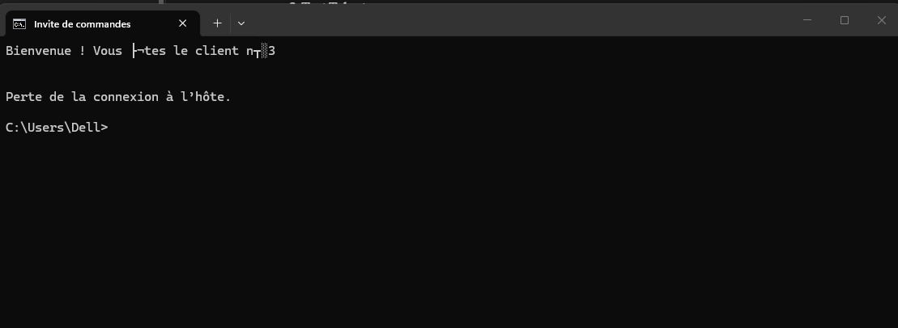
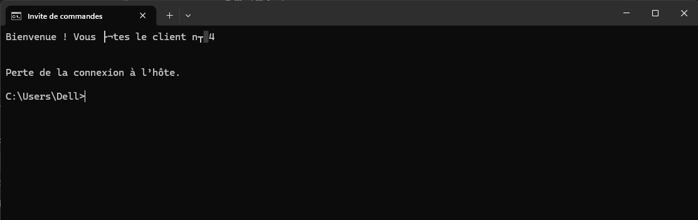
#### Adresse IP de la machine serveur

La commande `ipconfig` donne l'adresse IPv4 de la carte Wi-Fi du serveur : `192.168.1.118` (masque 255.255.255.0, passerelle 192.168.1.1). Les clients des autres machines utilisent cette adresse pour se connecter.

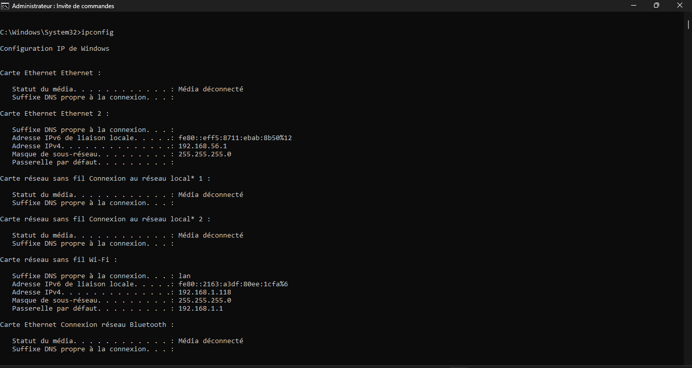

#### Vérification de la connectivité (ping)

Avant le test de l'application, la commande `ping 192.168.1.118` (IP du serveur) envoie 4 paquets et en reçoit 4, sans perte : les deux machines se joignent sur le réseau local.

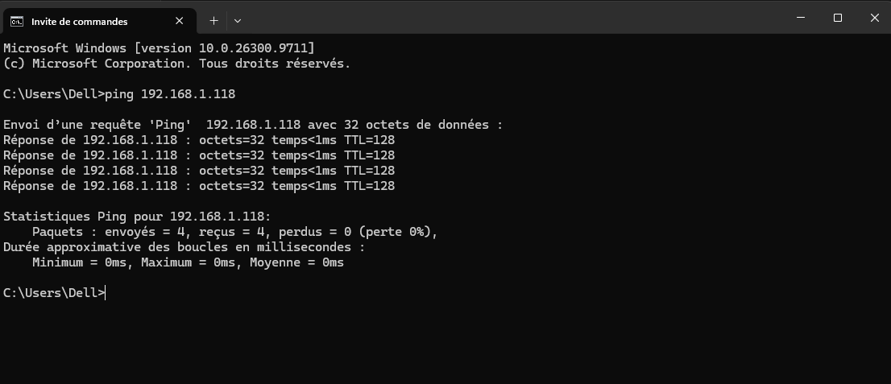

#### Test en réseau local : client Telnet sur un téléphone (Termux)

Depuis un téléphone connecté au même réseau Wi-Fi, la commande `telnet 192.168.1.118 1234` (Termux) se connecte au PC serveur. Le serveur répond « Bienvenue ! Vous êtes le client n°1 » puis ferme la connexion : le serveur est bien accessible depuis une autre machine du réseau local.

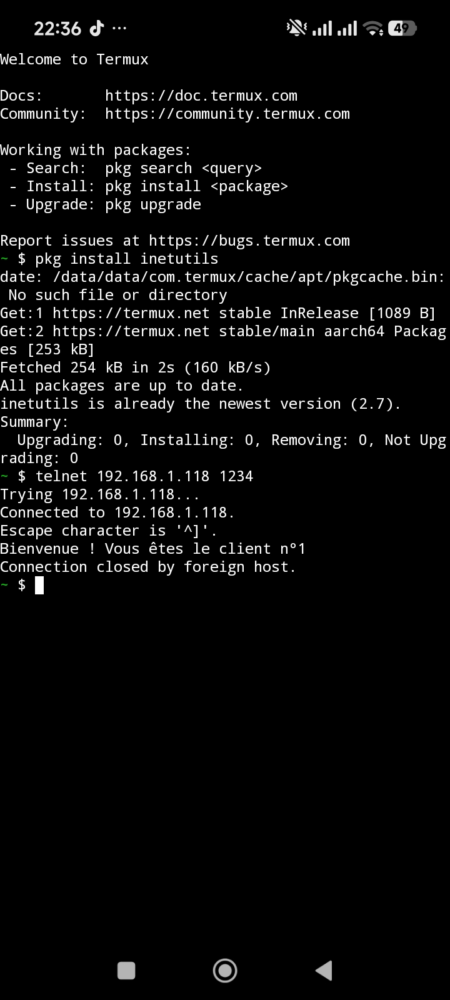
#### Démarrage du serveur calculatrice

Le serveur multi-thread `ServerMT3_2` démarre sur le port 1234 et attend les connexions des clients.

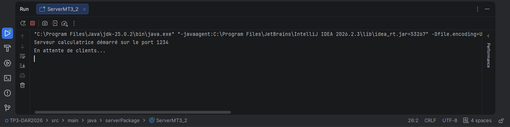

#### Test local : consoles des 3 clients en parallèle

Trois clients `Client3_2` sont connectés en même temps au serveur. Chacun reçoit son numéro d'ordre (n°1, n°2, n°3) et envoie sa propre opération : `10 + 20` (résultat 30.0), `12 / 2` (résultat 6.0) , `200 * 3` (résultat 600.0) et `30 * 10` (résultat 300.0). Le serveur les traite en parallèle, avec un thread par client.

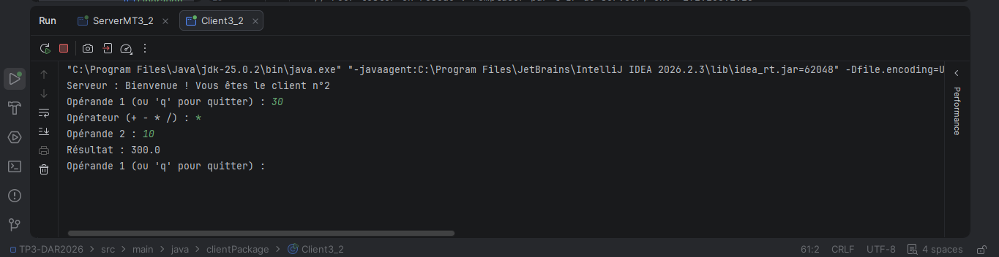
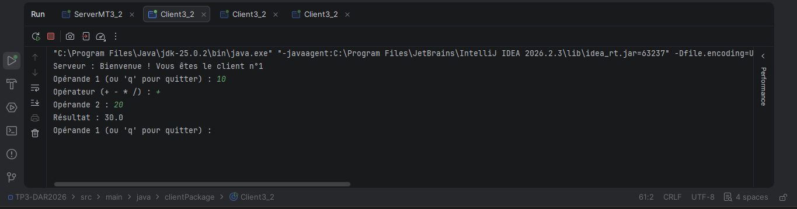
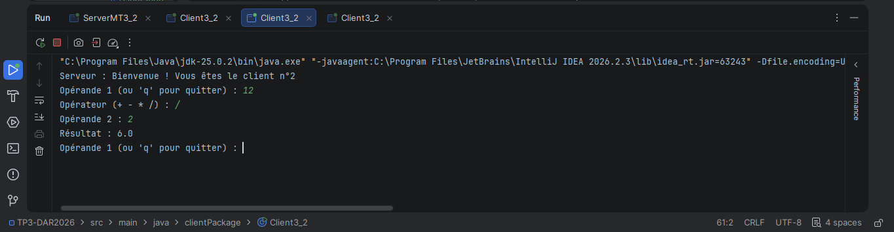

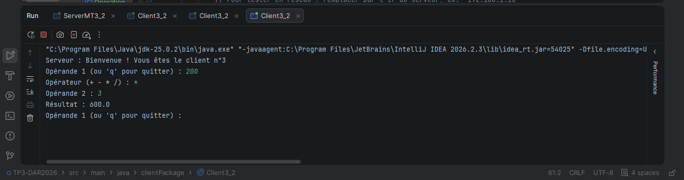

#### Compteur global des opérations traitées

Pour chaque opération, le serveur affiche le calcul et la valeur du compteur global (`Opérations traitées au total`) : 1 après `12.0 + 10.0 = 22.0`, puis 2 après `30.0 * 10.0 = 300.0`. Le compteur est partagé entre tous les threads et protégé par `synchronized`, il reste donc cohérent.

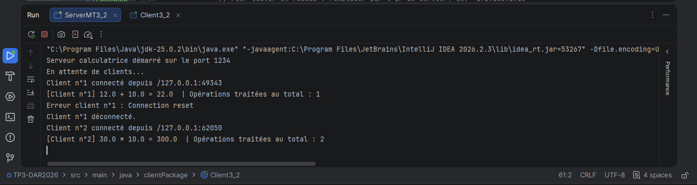
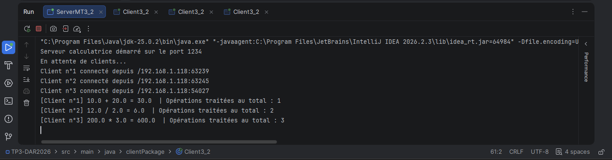

#### Test local : 3 clients connectés simultanément

Le serveur `ServerMT3_2` écoute sur le port 1234. Trois instances de `Client3_2` se connectent en même temps : le serveur leur attribue les numéros 1, 2 et 3 (un port source différent pour chacun) et les traite en parallèle, avec un thread par client.

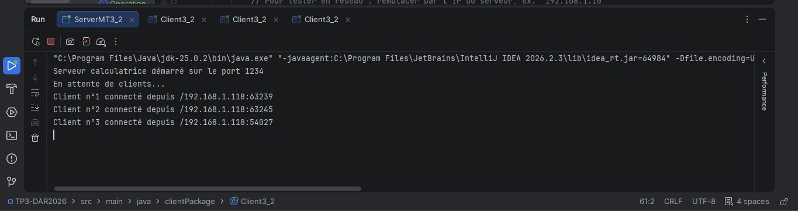

## Lien GitHub

https://github.com/RihabTarchi/TP3-DAR2026
